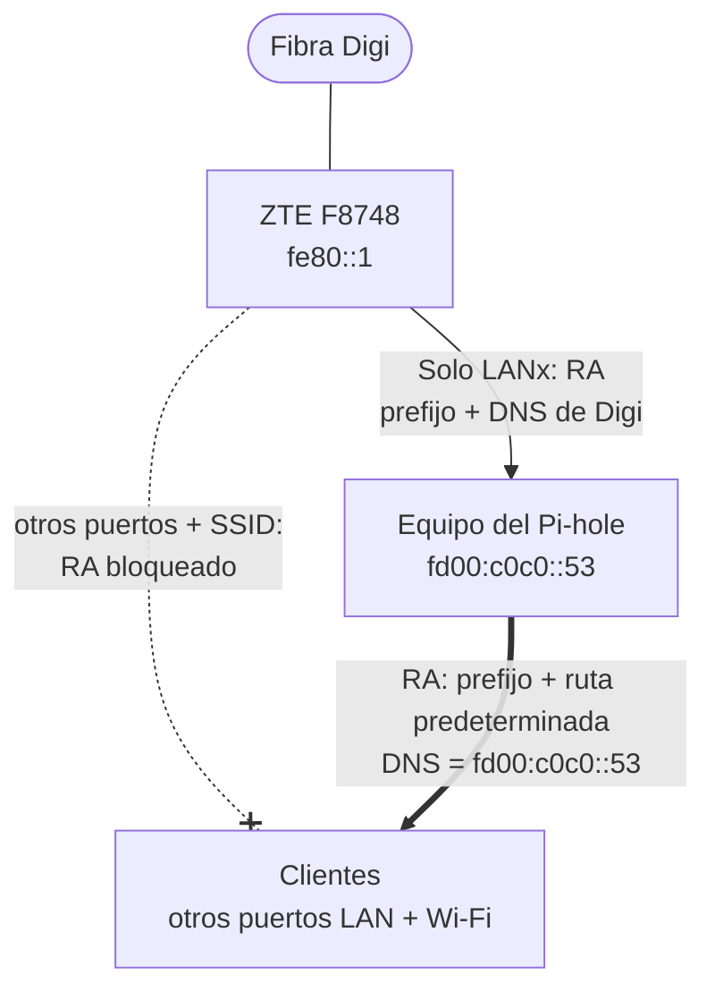

# IPv6 + Pi-hole en el ZTE F8748 de Digi (y cómo solucionarlo)

[English](README.md) · [Português](README.pt.md) · **Español**

> 🌐 **Traducción automática.** Este archivo se ha traducido automáticamente a partir del [README en inglés](README.md). En caso de duda o discrepancia, la versión en inglés es la de referencia.

Si tienes fibra de **Digi** con el router **ZTE ZXHN F8748** y usas **Pi-hole** (o AdGuard Home, o simplemente dnsmasq), activar IPv6 en tu red local se salta silenciosamente tu filtrado de DNS.

El router anuncia los servidores DNS IPv6 de la propia Digi a todos los dispositivos, y **no hay ninguna opción que lo impida**.

Hay una opción de "DNS manual": el router la ignora por completo.

Así que, Digi: no es enfado, es decepción. No, espera. Es enfado. Muchísimo enfado. Es la versión informática de un casero que se queda con una copia de la llave y entra cuando le da la gana a colgar un retrato de sí mismo encima de tu foto de familia en el pasillo.

Dejad que la gente controle sus dispositivos y configure su propio DNS. Llevamos décadas haciendo exactamente eso con IPv4. ¿Con qué derecho venís a secuestrar nuestras configuraciones IPv6?

Este repositorio documenta lo que hace realmente el router, todo lo que *no* lo soluciona, y una solución que sí funciona: que el equipo del Pi-hole envíe los anuncios de router (Router Advertisements) IPv6 en lugar del router.

> Probado en Digi **Portugal**. Usuarios de Digi España informan del mismo comportamiento en el F8748 y en routers ZTE más antiguos de Digi (H298Q, H3600P), por ejemplo en [bandaancha.eu](https://bandaancha.eu/foros/desactivar-dns-digi-ipv6-router-zte-zxhn-1757717).

---

## Índice

- [Resumen](#resumen)
- [El problema](#el-problema)
  - [Qué anuncia el router](#qué-anuncia-el-router)
  - [Lo que no funciona](#lo-que-no-funciona)
  - [Extra: el prefijo tampoco es fijo](#extra-el-prefijo-tampoco-es-fijo)
- [La solución](#la-solución)
  - [Requisitos](#requisitos)
- [Paso a paso](#paso-a-paso)
  - [1. Router (ZTE F8748)](#1-router-zte-f8748)
  - [2. Equipo del Pi-hole: una dirección DNS fija (ULA)](#2-equipo-del-pi-hole-una-dirección-dns-fija-ula)
  - [3. Equipo del Pi-hole: reenvío IPv6](#3-equipo-del-pi-hole-reenvío-ipv6)
  - [4. Pi-hole: enviar los RA](#4-pi-hole-enviar-los-ra)
  - [5. Comprobar desde un cliente](#5-comprobar-desde-un-cliente)
  - [6. Limpiar los clientes](#6-limpiar-los-clientes)
- [Qué pasa cuando cambia el prefijo](#qué-pasa-cuando-cambia-el-prefijo)
- [Advertencias](#advertencias)
- [Probado con](#probado-con)

---

## Resumen

1. En el ZTE: deja el **RA Service activado**, pero en **Port Control** activa el RA **solo en el puerto donde está conectado el equipo del Pi-hole**. Desactiva DHCPv6 en todos.
2. En el equipo del Pi-hole: añade una **ULA** fija (por ejemplo `fd00:c0c0::53`) para que la dirección DNS que reciben los clientes no cambie nunca.
3. En el equipo del Pi-hole: asegúrate de que el **reenvío IPv6** (forwarding) está activado.
4. En Pi-hole: activa el servidor DHCP con **"Enable additional IPv6 support (SLAAC + RA)"**.
5. Resultado: los clientes reciben direcciones IPv6, una ruta predeterminada y DNS del equipo del Pi-hole. El DNS de Digi nunca les llega.

---

## El problema

### Qué anuncia el router

Con IPv6 activado en la red local, el F8748 envía Router Advertisements (RA) para SLAAC. Esos RA incluyen una opción **RDNSS** (RFC 8106) con los servidores DNS de Digi:

```text
$ rdisc6 eth0
 ...
 Prefix                   : 2001:db8:1234:5600::/64
  On-link                 :          Yes
  Autonomous address conf.:          Yes
 Recursive DNS server     : 2a12:26c0:0:1::1
 Recursive DNS server     : 2a12:26c0:0:2::1
  DNS servers lifetime    :          900 (0x00000384) seconds
 from fe80::1
```

(`2001:db8::/32` es un prefijo de documentación que sustituye a tu prefijo real. Los dos servidores DNS son los servidores reales de Digi.)

Todos los clientes los reciben. Android *solo* usa RDNSS para el DNS IPv6, y Linux, Windows, macOS e iOS los usan tan tranquilos junto a tu Pi-hole, y a menudo en su lugar. Tu filtrado tiene ahora un agujero del tamaño de tu ISP.

### Lo que no funciona

Todo esto está en los ajustes **LAN → IPv6** del router:

| Intento | Resultado |
| --- | --- |
| **DNS Delegate Type: Auto** ("DNS Address Through") | Pasa el DNS de Digi directamente a los clientes. Es la opción predeterminada. |
| **DNS Delegate Type: Manual**, campos de DNS vacíos | Rechazado: *"Please configure one DNS server address at least."* |
| **Manual** con la dirección IPv6 de tu Pi-hole | Primero falla con *"The prefixes to be delegated cannot be empty"* (solución: poner el **Prefix Delegate Type** de DHCPv6 en **Disabled**). Después se guarda y se mantiene al recargar la página, **pero los RA siguen anunciando el DNS de Digi.** |
| Desactivar y volver a activar el RA Service | Ningún cambio. |
| Reiniciar el router | Ningún cambio. |
| Flags M/O desactivados, servidor DHCPv6 desactivado | Ajustes correctos para SLAAC, pero el RDNSS sigue siendo el de Digi. |
| Desactivar el RA por completo | Ya no hay IPv6 en la red local. Vuelta a empezar. |

Por lo visto, la opción de DNS manual solo alimenta al servidor DHCPv6 del router, que la mayoría de los clientes nunca usa. El RDNSS de los RA está fijado a lo que Digi proporcione por el lado WAN.

### Extra: el prefijo tampoco es fijo

El RA anuncia el prefijo con tiempos de vida válido y preferido **infinitos**, lo que sugiere que es estático. No lo es: cambia con cada reinicio del router y con cada reconexión de la WAN. Así que, aunque la opción de DNS manual funcionara, fijar en el router una dirección IPv6 del Pi-hole dejaría de funcionar la próxima vez que se cayera la conexión.

---

## La solución

Usar el propio **Port Control** del router para limitar sus RA a un único puerto, el del equipo del Pi-hole, y que el equipo del Pi-hole envíe los RA a todos los demás.



- El equipo del Pi-hole recibe el prefijo actual del ZTE (es el único dispositivo que oye los RA del ZTE).
- El dnsmasq del Pi-hole vuelve a anunciar ese prefijo a la red local, con **él mismo** como servidor DNS y como router IPv6 predeterminado. El servidor DNS es una dirección privada fija (una ULA) en el equipo del Pi-hole, así que no cambia cuando cambia el prefijo.
- Los clientes envían el tráfico IPv6 al equipo del Pi-hole, que lo reenvía al ZTE. El tráfico de vuelta va directamente del ZTE al cliente, porque el prefijo está en el mismo enlace (on-link).
- Cuando Digi cambia el prefijo, el equipo del Pi-hole recibe el nuevo y dnsmasq lo anuncia automáticamente, dejando obsoleto el antiguo.

En la práctica, el equipo del Pi-hole apenas transporta tráfico. Como reenvía los paquetes por la misma interfaz por la que llegaron, Linux envía a los clientes redirecciones ICMPv6 que apuntan al ZTE, y tras los primeros paquetes la mayor parte del tráfico va directamente al router (`ip -6 route show cache` en un cliente muestra entradas `via fe80::1`). Es inofensivo y le quita carga a la Pi, pero explica por qué un traceroute puede no mostrar el equipo del Pi-hole. El DNS no se ve afectado: sigue yendo adonde diga el RA.

### Requisitos

- Un equipo Linux (probado con una RPi 4; casi cualquier cosa que no sea literalmente una tostadora debería valer) con Pi-hole (o dnsmasq, o tu servicio de DNS favorito), que pueda estar **solo en un puerto LAN del ZTE**. Si comparte un switch con otros dispositivos, esos dispositivos también oirán los RA del ZTE y recibirán el DNS de Digi.
- Con Docker: el contenedor del Pi-hole necesita `network_mode: host` y `cap_add: [NET_ADMIN]`. O puedes ejecutarlo directamente y ahorrarte algún que otro dolor de cabeza.

---

## Paso a paso

### 1. Router (ZTE F8748)

**LAN → IPv6** (la ruta exacta en el menú puede variar según la versión de firmware):

- **DHCPv6 Server:** desactivado. Los ajustes de DNS de aquí dejan de importar.
- **RA Service:** activado, **M:** desactivado, **O:** desactivado, **Prefix Delegate Type:** Auto (si lo cambiaste a Disabled al probar el DNS manual, vuelve a ponerlo en Auto).
- **Port Control:**
  - **RA** marcado **solo** en el puerto LAN donde está conectado el equipo del Pi-hole.
  - **RA** desmarcado en todos los demás puertos LAN y en **todos los SSID**.
  - **DHCPv6** desmarcado en todos (incluido el puerto del equipo del Pi-hole).

Cada sección tiene su propio botón **Apply**, que solo guarda esa sección. Púlsalo después de cambiar cada una.

Ya que estás, revisa el nivel del **firewall IPv6** del router. Con IPv6 activado, todos los dispositivos tienen una dirección pública, y filtrar el tráfico entrante es cosa del router.

### 2. Equipo del Pi-hole: una dirección DNS fija (ULA)

Pi-hole indica a los clientes que usen sus propias direcciones como servidores DNS. Dale una que no cambie nunca: una **ULA**, una dirección IPv6 privada, el equivalente a `192.168.x.x`.

Elige cualquier dirección dentro de `fd00::/8`. Esta guía usa `fd00:c0c0::53` (`53` es el puerto del DNS; `c0c0` se lee «cocó», que en portugués es caca: una valoración justa del firmware del ZTE). El RFC 4193 dice que los bits después de `fd` deberían ser aleatorios, lo que solo importa si algún día unes esta red a otra mediante una VPN; evita el simple `fd00::/64`, que usan muchas redes domésticas.

Con NetworkManager (por ejemplo, Raspberry Pi OS). Averigua el nombre de tu conexión con `nmcli -t -f NAME,DEVICE con show --active`:

```bash
sudo nmcli con mod "Wired connection 1" +ipv6.addresses fd00:c0c0::53/64
sudo nmcli con up "Wired connection 1"           # la red se cae unos segundos
ip -6 addr show eth0                             # debería aparecer fd00:c0c0::53 en la lista
```

Con la Opción A del paso 4 no hace falta nada más: la configuración de dnsmasq que genera Pi-hole ya anuncia la ULA del equipo como servidor DNS (es el `[fd00::]` de su línea `option6:dns-server`). No añadas tu propia línea `dhcp-option=option6:dns-server`; entraría en conflicto con la de Pi-hole.

#### ¿Por qué no la dirección global?

En resumen: con la Opción A, los clientes siguen recibiendo una de las direcciones globales del equipo como servidor DNS, porque es Pi-hole quien genera esa línea. La ULA no elimina el problema de la dirección desactualizada; lo vuelve inofensivo.

La línea `option6:dns-server` de Pi-hole anuncia también una de las direcciones globales del equipo (el `[::]`), y al principio me fiaba de eso. Funciona, pero no conviene depender de ello:

- La dirección global cambia con el prefijo, es decir, con cada reinicio del router y cada reconexión de la WAN.
- Tras un cambio de prefijo, dnsmasq siguió anunciando una dirección global **antigua y obsoleta**, aunque ya había una más reciente en uso. Solo cambió después de reiniciar la conexión de red del equipo (`nmcli con up`). Las direcciones obsoletas caducan al cabo de unas dos horas, y a partir de ahí los clientes podrían quedarse con un servidor DNS que ya no existe.

Los clientes reciben también la ULA y la dirección link-local del equipo, así que el filtrado sigue funcionando en cualquier caso; la dirección desactualizada solo provoca consultas lentas mientras los clientes esperan al timeout. Es la ULA lo que lo hace fiable.

Si aun así quieres una dirección global predecible (útil para pruebas y para saber dónde está tu Pi-hole), una dirección con **token** mantiene un sufijo fijo (`::2`) sobre el prefijo que esté vigente:

```bash
sudo nmcli con mod "Wired connection 1" \
  ipv6.method auto ipv6.addr-gen-mode eui64 ipv6.token ::2
sudo nmcli con up "Wired connection 1"           # la red se cae unos segundos
ip -6 addr show eth0                             # debería aparecer <prefijo>::2
```

`addr-gen-mode eui64` es obligatorio; NetworkManager ignora el token en el modo stable-privacy, que es el predeterminado.

### 3. Equipo del Pi-hole: reenvío IPv6

El equipo pasa a ser la puerta de enlace IPv6 de la red local, así que tiene que reenviar tráfico:

```bash
sysctl net.ipv6.conf.all.forwarding          # debería ser 1
sudo ip6tables -S FORWARD | head             # revisa la política / las cadenas de Docker
```

Para activarlo de forma permanente:

```bash
echo 'net.ipv6.conf.all.forwarding=1' | sudo tee /etc/sysctl.d/90-ipv6-forward.conf
sudo sysctl --system
```

Notas:

- Si usas Tailscale como subnet router o exit node, probablemente el reenvío ya está activado.
- Docker puede poner la política FORWARD de ip6tables en `DROP`. En ese caso, permite el tráfico red local → router con `sudo ip6tables -I DOCKER-USER -i eth0 -o eth0 -j ACCEPT`. Esa regla se pierde al reiniciar; más abajo se explica cómo hacerla permanente.
- En un equipo que **no** use NetworkManager, activar el reenvío hace que el kernel ignore los RA, salvo que también configures `net.ipv6.conf.eth0.accept_ra=2`. Si no, el equipo pierde su propia dirección IPv6. NetworkManager gestiona los RA por su cuenta, así que no le afecta.

Si `sudo ip6tables -S FORWARD` muestra `-P FORWARD DROP` y has añadido la regla de arriba, hazla permanente con una pequeña unidad de systemd que se ejecute cada vez que arranque Docker:

```ini
# /etc/systemd/system/docker-ipv6-forward.service
[Unit]
Description=Allow IPv6 LAN to router forwarding past Docker's firewall
After=docker.service
Requires=docker.service
PartOf=docker.service

[Service]
Type=oneshot
RemainAfterExit=yes
ExecStart=/bin/sh -c 'ip6tables -C DOCKER-USER -i eth0 -o eth0 -j ACCEPT 2>/dev/null || ip6tables -I DOCKER-USER -i eth0 -o eth0 -j ACCEPT'
ExecStop=-/bin/sh -c 'ip6tables -D DOCKER-USER -i eth0 -o eth0 -j ACCEPT'

[Install]
WantedBy=docker.service
```

```bash
sudo systemctl daemon-reload
sudo systemctl enable --now docker-ipv6-forward.service
```

`netfilter-persistent save` también sirve, pero guarda también las reglas del propio Docker, y restaurarlas al arrancar puede chocar con las que crea Docker.

### 4. Pi-hole: enviar los RA

#### Opción A (la que usé): el servidor DHCP de Pi-hole

Settings → DHCP:

- Activa el **DHCP server** (también servirá IPv4 en el rango que definas; deja los equipos con IP estática fuera de ese rango).
- Si el ZTE sigue teniendo activo su propio **servidor DHCP IPv4**, desactívalo. Dos servidores DHCP en la misma red significa que los clientes se quedan con el que responda primero.
- Marca **"Enable additional IPv6 support (SLAAC + RA)"**.

#### Opción B (sin probar): RA sin DHCP

Settings → All settings (expert) → Miscellaneous → `misc.dnsmasq_lines`:

```text
enable-ra
dhcp-range=::,constructor:eth0,ra-only
ra-param=eth0,60,1800
dhcp-option=option6:dns-server,[fd00::],[fe80::]
```

`constructor:eth0` copia los prefijos que haya en cada momento en `eth0`, así que los cambios de prefijo se siguen automáticamente. `ra-param` fija un intervalo de 60 s entre RA y un tiempo de vida de router de 1800 s. La línea `dhcp-option` anuncia como servidores DNS la ULA del equipo (`[fd00::]`, la dirección del paso 2) y su dirección link-local (`[fe80::]`), los mismos marcadores que usa Pi-hole en la Opción A; con el servidor DHCP de Pi-hole desactivado, Pi-hole no genera esta línea por sí solo.

Con dnsmasq a secas (sin Pi-hole), las líneas de la Opción B funcionan tal cual en un archivo de configuración de dnsmasq.

### 5. Comprobar desde un cliente

```bash
rdisc6 <interfaz>
```

Lo que quieres ver es **un único** origen de RA, la dirección link-local del equipo del Pi-hole, con un tiempo de vida de router distinto de cero y solo el Pi-hole como DNS:

```text
Stateful address conf.    :           No
Stateful other conf.      :          Yes
Router lifetime           :         1800 (0x00000708) seconds
 Prefix                   : fd00:c0c0::/64
  Autonomous address conf.:          Yes
 Prefix                   : 2001:db8:1234:5600::/64
  Autonomous address conf.:          Yes
 Recursive DNS server     : 2001:db8:1234:5600:xxxx:xxxx:xxxx:xxxx
 Recursive DNS server     : fd00:c0c0::53
 Recursive DNS server     : fe80::xxxx:xxxx:xxxx:xxxx
 from fe80::xxxx:xxxx:xxxx:xxxx
```

(Con la Opción B, `Stateful other conf.` muestra `No`. Es lo esperado, porque no hay DHCPv6. Con la Opción A, cada servidor DNS aparece dos veces; así es como Pi-hole escribe la opción, y es inofensivo.)

Ningún servidor `2a12:26c0:…`, ningún RA desde `fe80::1`. ¿Los sigues viendo en un dispositivo que ya estaba conectado? Mira el [paso 6](#6-limpiar-los-clientes). Después:

```bash
ip -6 route                                   # una única ruta predeterminada, vía el equipo del Pi-hole
ping -6 -c3 google.com                        # el enrutamiento IPv6 funciona
resolvectl status <interfaz>                  # solo aparecen direcciones del Pi-hole
dig @fd00:c0c0::53 doubleclick.net AAAA       # debería dar ::  (bloqueado)
dig @fd00:c0c0::53 example.com AAAA           # debería dar una dirección real
```

### 6. Limpiar los clientes

Los dispositivos que estaban conectados mientras les llegaban los RA del ZTE se quedan con restos. Los servidores DNS de Digi (tiempo de vida de 15 min) y la ruta predeterminada extra vía `fe80::1` (30 min) caducan solos. Las direcciones de un prefijo antiguo puede que no: el ZTE las anunció con tiempo de vida infinito, y si ese prefijo se sustituyó sin marcarse como obsoleto, la dirección se queda. El cliente puede entonces usarla como dirección de origen, y el IPv6 falla de forma intermitente. Vuelve a conectar cada dispositivo una vez (desactiva y activa el Wi-Fi, reinicia, o `nmcli device disconnect <if> && nmcli device connect <if>`) para limpiarlo todo de golpe.

---

## Qué pasa cuando cambia el prefijo

El prefijo cambia con cada reinicio del router **y** con cada reconexión de la WAN (por ejemplo, un corte de la fibra), así que cuenta con que pase en el uso normal. Probado de las dos formas:

1. El ZTE marca el prefijo antiguo como obsoleto y anuncia uno nuevo al equipo del Pi-hole.
2. El equipo del Pi-hole obtiene una dirección en el nuevo prefijo. La dirección antigua queda marcada como `deprecated` y caduca al cabo de ~2 horas (la regla de las dos horas del RFC 4862).
3. dnsmasq anuncia el nuevo prefijo y pasa el antiguo como obsoleto.
4. Los clientes obtienen una dirección del nuevo prefijo y empiezan a usarla enseguida. Sus direcciones antiguas caducan de la misma forma.
5. La dirección DNS que usan los clientes, `fd00:c0c0::53`, no cambia en absoluto.

Durante uno o dos segundos, mientras se comprueba que la nueva dirección del equipo del Pi-hole no está duplicada, dnsmasq anuncia un tiempo de vida de router de 0. Un cliente que oiga ese RA pierde brevemente su ruta IPv6 predeterminada. Se recupera solo: tras el cambio, los clientes volvieron a tener una única ruta predeterminada vía el equipo del Pi-hole.

No hace falta intervención manual.

---

## Advertencias

- **El equipo del Pi-hole pasa a ser tu puerta de enlace IPv6, y tu DNS.** Si se cae, los clientes pierden el IPv6 y el DNS (y, con la Opción A, acaban perdiendo las concesiones DHCP de IPv4). En la práctica: sin internet. Hora de irse de pícnic.
- **El aislamiento del puerto importa.** Todo lo que comparta el puerto del router del equipo del Pi-hole (por ejemplo, a través de un switch) también oye los RA del ZTE y recibe el DNS de Digi.
- **Las estadísticas de Pi-hole se vuelven más confusas.** Los clientes usan direcciones IPv6 de privacidad que van rotando, así que las estadísticas por cliente de las consultas IPv6 no se corresponden limpiamente con dispositivos.
- **DoH/DoT siguen saltándose Pi-hole**, igual que en IPv4. Eso es otro problema.
- **Todo recibe también una dirección ULA.** dnsmasq anuncia todos los prefijos de `eth0`, incluida la ULA, así que los clientes reciben una dirección `fd00:c0c0::…` además de la global. Siguen usando la global para internet. El equipo del Pi-hole también recoge su propio anuncio y obtiene una segunda dirección ULA (`fd00:c0c0::2` si configuraste el token `::2`). Ambas cosas son inofensivas; comprueba que la única ruta predeterminada del equipo sigue siendo `via fe80::1` (`ip -6 route show default`).

---

## Probado con

| | |
| --- | --- |
| ISP | Digi (Portugal), FTTH |
| Router | ZTE ZXHN F8748, firmware: *F8748 V3.0.10P2N9* |
| Equipo del Pi-hole | Raspberry Pi, Raspberry Pi OS (basado en Debian), NetworkManager |
| Pi-hole | v6, Docker, `network_mode: host`, `NET_ADMIN` |
| Clientes | Ubuntu 24.04 (NetworkManager + systemd-resolved) |

Si has probado esto en otros modelos ZTE de Digi o en otras versiones de firmware, los PR y las issues son bienvenidos.

## Aviso legal

Esto es una descripción de lo que funcionó en una red. El firmware de los routers cambia, los menús se mueven de sitio, y eres responsable de tu propia configuración. Sin ninguna relación con Digi, ZTE ni Pi-hole.
