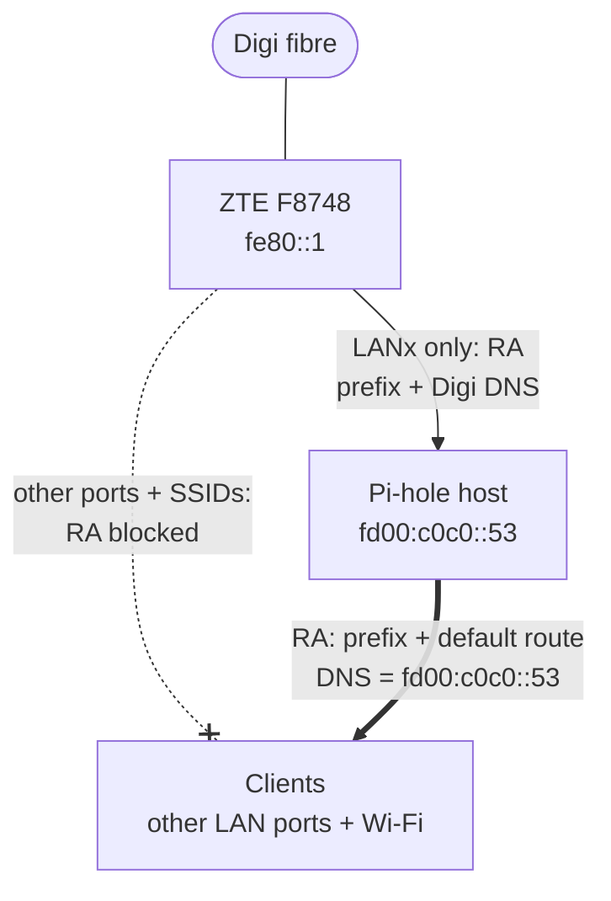

# IPv6 + Pi-hole on Digi's ZTE F8748 (and how to work around it)

**English** · [Português](README.pt.md) · [Español](README.es.md)

If you're on **Digi** fibre with their **ZTE ZXHN F8748** router and you run **Pi-hole** (or AdGuard Home, or plain dnsmasq), enabling IPv6 on your LAN quietly bypasses your DNS filtering.

The router advertises Digi's own IPv6 DNS servers to every device, and **there is no setting that stops it**.

There's a "Manual DNS" option: the router ignores it completely.

So, Digi: I'm not angry, just disappointed. No, wait. I'm extremely angry. This is the networking version of a landlord who keeps a spare key and lets themselves in to hang a portrait of themselves over your family photo in the hallway.

Let people control their devices and configure their own DNS. We've done exactly that with IPv4 for decades. What on earth entitles you to hijack our IPv6 setups?

This repo documents what the router actually does, everything that *doesn't* fix it, and a workaround that does: let the Pi-hole host send the IPv6 Router Advertisements instead of the router.

> Tested on Digi **Portugal**. Digi Spain users report the same behaviour on the F8748 and older Digi ZTE units (H298Q, H3600P), e.g. on [bandaancha.eu](https://bandaancha.eu/foros/desactivar-dns-digi-ipv6-router-zte-zxhn-1757717).

---

## Contents

- [TL;DR](#tldr)
- [The problem](#the-problem)
  - [What the router advertises](#what-the-router-advertises)
  - [What doesn't fix it](#what-doesnt-fix-it)
  - [Bonus: the prefix isn't static either](#bonus-the-prefix-isnt-static-either)
- [The workaround](#the-workaround)
  - [Requirements](#requirements)
- [Step by step](#step-by-step)
  - [1. Router (ZTE F8748)](#1-router-zte-f8748)
  - [2. Pi-hole host: a fixed DNS address (ULA)](#2-pi-hole-host-a-fixed-dns-address-ula)
  - [3. Pi-hole host: IPv6 forwarding](#3-pi-hole-host-ipv6-forwarding)
  - [4. Pi-hole: send the RAs](#4-pi-hole-send-the-ras)
  - [5. Verify from a client](#5-verify-from-a-client)
  - [6. Clean up stale clients](#6-clean-up-stale-clients)
- [What happens when the prefix changes](#what-happens-when-the-prefix-changes)
- [Caveats](#caveats)
- [Tested with](#tested-with)

---

## TL;DR

1. On the ZTE: keep **RA Service on**, but in **Port Control** enable RA **only on the port your Pi-hole host is plugged into**. Uncheck DHCPv6 everywhere.
2. On the Pi-hole host: add a fixed **ULA** (e.g. `fd00:c0c0::53`) so the DNS address clients get never changes.
3. On the Pi-hole host: make sure **IPv6 forwarding** is on.
4. In Pi-hole: enable the DHCP server with **"Enable additional IPv6 support (SLAAC + RA)"**.
5. Result: clients get IPv6 addresses, a default route and DNS from the Pi-hole host. Digi's DNS never reaches them.

---

## The problem

### What the router advertises

With IPv6 enabled on the LAN, the F8748 sends Router Advertisements (RAs) for SLAAC. Those RAs contain an **RDNSS** option (RFC 8106) listing Digi's resolvers:

```text
$ rdisc6 eth0
 ...
 Prefix                   : 2001:db8:1234:5600::/64
  On-link                 :          Yes
  Autonomous address conf.:          Yes
 Recursive DNS server     : 2a12:26c0:0:1::1
 Recursive DNS server     : 2a12:26c0:0:2::1
  DNS servers lifetime    :          900 (0x00000384) seconds
 from fe80::1
```

(`2001:db8::/32` is a documentation prefix standing in for your real one. The two DNS servers are Digi's real resolvers.)

Every client picks these up. Android *only* uses RDNSS for IPv6 DNS, and Linux, Windows, macOS and iOS will all happily use them alongside (or almost certainly, instead of) your Pi-hole. Your filtering now has a hole the size of your ISP.

### What doesn't fix it

All of this is in the router's **LAN → IPv6** settings:

| Attempt | Result |
| --- | --- |
| **DNS Delegate Type: Auto** ("DNS Address Through") | Passes Digi's DNS straight to clients. This is the default. |
| **DNS Delegate Type: Manual**, DNS fields empty | Refused: *"Please configure one DNS server address at least."* |
| **Manual** with your Pi-hole's IPv6 address | First fails with *"The prefixes to be delegated cannot be empty"* (fix: set DHCPv6 **Prefix Delegate Type** to **Disabled**). Then it saves and persists across reloads, **but the RAs still advertise Digi's DNS.** |
| Toggling RA Service off/on | No change. |
| Rebooting the router | No change. |
| M/O flags off, DHCPv6 server off | Correct settings for SLAAC, but RDNSS is still Digi's. |
| Turning RA off entirely | No IPv6 on the LAN at all. Back to square one. |

The Manual DNS setting apparently only feeds the router's DHCPv6 server, which most clients never use. The RA's RDNSS is hardwired to whatever Digi provides on the WAN side.

### Bonus: the prefix isn't static either

The RA advertises the prefix with **infinite** valid and preferred lifetimes, which suggests it's static. It isn't: it changes on every router reboot and every WAN reconnect. So even if the Manual DNS setting worked, pinning a Pi-hole IPv6 address in the router would break the next time the connection drops.

---

## The workaround

Use the router's own **Port Control** to limit its RAs to a single port, the one your Pi-hole host is on, and have the Pi-hole host send RAs to everyone else.



- The Pi-hole host gets the current prefix from the ZTE (it's the only device that hears the ZTE's RAs).
- Pi-hole's dnsmasq re-advertises that prefix to the LAN, with **itself** as the DNS server and the IPv6 default router. The DNS server is a fixed private address (a ULA) on the Pi-hole host, so it doesn't change when the prefix does.
- Clients send IPv6 traffic to the Pi-hole host, which forwards it to the ZTE. Return traffic goes from the ZTE straight to the client, since the prefix is on-link.
- When Digi changes the prefix, the Pi-hole host picks up the new one and dnsmasq advertises it automatically, deprecating the old one.

In practice the Pi-hole host carries very little of the traffic. It forwards packets back out the same interface they arrived on, so Linux sends clients ICMPv6 redirects pointing at the ZTE, and after the first few packets most traffic goes straight to the router (`ip -6 route show cache` on a client shows entries `via fe80::1`). That's harmless and keeps load off the Pi, but it's why traceroutes may not show the Pi-hole host. DNS is unaffected: it still goes wherever the RA says.

### Requirements

- A Linux host (tested with an RPi 4, almost anything short of an actual toaster should work) running Pi-hole (or dnsmasq, or your brand of DNS service) that can sit **alone on its own ZTE LAN port**. If it shares a switch with other devices, those devices will also hear the ZTE's RAs and get Digi's DNS.
- For Docker: the Pi-hole container needs `network_mode: host` and `cap_add: [NET_ADMIN]`. Or you can run it directly and save yourself some headaches.

---

## Step by step

### 1. Router (ZTE F8748)

**LAN → IPv6** (the exact menu path may differ between firmware versions):

- **DHCPv6 Server:** Off. DNS settings here no longer matter.
- **RA Service:** On, **M:** Off, **O:** Off, **Prefix Delegate Type:** Auto (if you set it to Disabled while trying Manual DNS, set it back).
- **Port Control:**
  - **RA** checked **only** on the LAN port the Pi-hole host is plugged into.
  - **RA** unchecked on all other LAN ports and **all SSIDs**.
  - **DHCPv6** unchecked everywhere (including the Pi-hole host).

Click **Apply** under *each* section you change. The ZTE might save them separately (or not, who knows).

While you're there, check the router's **IPv6 firewall** level. Once IPv6 is on, every device has a public address, and inbound filtering is the router's job.

### 2. Pi-hole host: a fixed DNS address (ULA)

Pi-hole tells clients to use its own addresses as DNS servers. Give it one that never changes: a **ULA**, a private IPv6 address, the equivalent of `192.168.x.x`.

Pick any address in `fd00::/8`. This guide uses `fd00:c0c0::53` (`53` being the DNS port, `c0c0` being a fair review of the ZTE's firmware). RFC 4193 says the bits after `fd` should be random, which only matters if you ever join this network to another one over a VPN; avoid plain `fd00::/64`, which a lot of home networks use.

With NetworkManager (e.g. Raspberry Pi OS). Find your connection's name with `nmcli -t -f NAME,DEVICE con show --active`:

```bash
sudo nmcli con mod "Wired connection 1" +ipv6.addresses fd00:c0c0::53/64
sudo nmcli con up "Wired connection 1"           # drops the network for a few seconds
ip -6 addr show eth0                             # expect fd00:c0c0::53 in the list
```

With Option A in step 4, nothing else is needed: Pi-hole's generated dnsmasq config already advertises the host's ULA as a DNS server (that's the `[fd00::]` in its `option6:dns-server` line). Don't add your own `dhcp-option=option6:dns-server` line on top of it; it would conflict with Pi-hole's.

#### Why not the global address?

Pi-hole's same line also advertises one of the host's global addresses (the `[::]`), and that's what I relied on at first. It works, but it isn't something to depend on:

- The global address changes with the prefix, i.e. on every router reboot and WAN reconnect.
- After a prefix change, dnsmasq kept advertising an **old, deprecated** global address, even while a newer one was current. It only switched after the host's network connection was restarted (`nmcli con up`). Deprecated addresses expire within a couple of hours, after which clients could be left with a DNS server that no longer exists.

Clients also get the ULA and the host's link-local address, so filtering keeps working either way; the stale address only costs slow lookups while clients time out on it. The ULA is what makes it reliable.

If you still want a predictable global address (handy for testing and for knowing where your Pi-hole is), a **tokenised** address keeps a fixed suffix (`::2`) on whatever prefix is current:

```bash
sudo nmcli con mod "Wired connection 1" \
  ipv6.method auto ipv6.addr-gen-mode eui64 ipv6.token ::2
sudo nmcli con up "Wired connection 1"           # drops the network for a few seconds
ip -6 addr show eth0                             # expect <prefix>::2
```

`addr-gen-mode eui64` is required; NetworkManager ignores the token in its default stable-privacy mode.

### 3. Pi-hole host: IPv6 forwarding

The host becomes the LAN's IPv6 gateway, so it has to forward:

```bash
sysctl net.ipv6.conf.all.forwarding          # want 1
sudo ip6tables -S FORWARD | head             # check the policy / Docker chains
```

To enable it persistently:

```bash
echo 'net.ipv6.conf.all.forwarding=1' | sudo tee /etc/sysctl.d/90-ipv6-forward.conf
sudo sysctl --system
```

Notes:

- If you use Tailscale as a subnet router or exit node, forwarding is probably already on.
- Docker may set the ip6tables FORWARD policy to `DROP`. If so, allow LAN → router traffic, e.g. `sudo ip6tables -I DOCKER-USER -i eth0 -o eth0 -j ACCEPT`.
- On a host **not** using NetworkManager, enabling forwarding makes the kernel ignore RAs unless you also set `net.ipv6.conf.eth0.accept_ra=2`. Otherwise the host loses its own IPv6 address. NetworkManager handles RAs itself, so it isn't affected.

### 4. Pi-hole: send the RAs

#### Option A (what I used): Pi-hole's DHCP server

Settings → DHCP:

- Enable the **DHCP server** (it will also serve IPv4 in the range you set; keep static hosts outside that range).
- If the ZTE is still running its own **IPv4 DHCP server**, turn it off. Two DHCP servers on one LAN means clients take whichever answers first.
- Tick **"Enable additional IPv6 support (SLAAC + RA)"**.

#### Option B (untested): RA without DHCP

Settings → All settings (expert) → Miscellaneous → `misc.dnsmasq_lines`:

```text
enable-ra
dhcp-range=::,constructor:eth0,ra-only
ra-param=eth0,60,1800
dhcp-option=option6:dns-server,[fd00:c0c0::53],[fe80::]
```

`constructor:eth0` copies the prefixes currently on `eth0`, so prefix changes are followed automatically. `ra-param` sets a 60 s RA interval and an 1800 s router lifetime. The `dhcp-option` line advertises the ULA from step 2 and the host's link-local address as DNS servers; with Pi-hole's DHCP server off, Pi-hole doesn't generate this line itself.

For plain dnsmasq (no Pi-hole), Option B's lines work in a dnsmasq config file as-is.

### 5. Verify from a client

```bash
rdisc6 <interface>
```

You want **one** RA source, the Pi-hole host's link-local address, with a non-zero router lifetime and only the Pi-hole as DNS:

```text
Stateful address conf.    :           No
Stateful other conf.      :          Yes
Router lifetime           :         1800 (0x00000708) seconds
 Prefix                   : fd00:c0c0::/64
  Autonomous address conf.:          Yes
 Prefix                   : 2001:db8:1234:5600::/64
  Autonomous address conf.:          Yes
 Recursive DNS server     : 2001:db8:1234:5600:xxxx:xxxx:xxxx:xxxx
 Recursive DNS server     : fd00:c0c0::53
 Recursive DNS server     : fe80::xxxx:xxxx:xxxx:xxxx
 from fe80::xxxx:xxxx:xxxx:xxxx
```

(With Option B, `Stateful other conf.` shows `No`. That's expected, since there's no DHCPv6. With Option A, each DNS server is listed twice; that's how Pi-hole writes the option, and it's harmless.)

No `2a12:26c0:…` resolvers, no RA from `fe80::1`. Still seeing them on a device that was connected before? See [step 6](#6-clean-up-stale-clients). Then:

```bash
ip -6 route                                   # single default route via the Pi-hole host
ping -6 -c3 google.com                        # IPv6 routing works
resolvectl status <interface>                 # only Pi-hole addresses listed
dig @fd00:c0c0::53 doubleclick.net AAAA       # expect ::  (blocked)
dig @fd00:c0c0::53 example.com AAAA           # expect a real address
```

### 6. Clean up stale clients

Devices that were connected while the ZTE's RAs reached them have leftovers. Digi's DNS servers (15 min lifetime) and the extra default route via `fe80::1` (30 min) expire on their own. Addresses from an old prefix may not: the ZTE advertised them with an infinite lifetime, and if that prefix was replaced without being deprecated, the address stays. A client may then use it as a source address, so IPv6 fails intermittently. Reconnect each device once (toggle Wi-Fi, reboot, or `nmcli device disconnect <if> && nmcli device connect <if>`) to clear everything at once.

---

## What happens when the prefix changes

The prefix changes on every router reboot **and** every WAN reconnect (e.g. a fibre drop), so expect it to happen in normal use. Tested both ways:

1. The ZTE deprecates the old prefix and advertises a new one to the Pi-hole host.
2. The Pi-hole host picks up an address on the new prefix. The old address is marked `deprecated` and expires after ~2 hours (RFC 4862's two-hour rule).
3. dnsmasq advertises the new prefix and passes the old one on as deprecated.
4. Clients get an address from the new prefix and use it immediately. Their old addresses expire the same way.
5. The DNS address clients use, `fd00:c0c0::53`, doesn't change at all.

For a second or two, while the Pi-hole host's new address is still being checked for duplicates, dnsmasq advertises a router lifetime of 0. A client that hears that RA briefly drops its IPv6 default route. It recovers on its own: after the change, clients were back to a single default route via the Pi-hole host.

No manual intervention needed.

---

## Caveats

- **The Pi-hole host is now your IPv6 gateway.** If it's down, clients lose IPv6 (and probably IPv4, so hmm, time for a picnic).
- **Port isolation matters.** Anything sharing the Pi-hole host's router port (e.g. via a switch) also hears the ZTE's RAs and gets Digi's DNS.
- **Pi-hole stats get noisier.** Clients use rotating IPv6 privacy addresses, so per-client stats for IPv6 queries won't map neatly to devices.
- **DoH/DoT still bypass Pi-hole**, same as on IPv4. That's a separate problem.
- **Everything gets a ULA address too.** dnsmasq advertises every prefix on `eth0`, including the ULA, so clients get an `fd00:c0c0::…` address alongside their global one. They still use the global one for the internet. The Pi-hole host also picks up its own advertisement and gains a second ULA address (`fd00:c0c0::2` if you set the `::2` token). Both are harmless; check that the host's only default route is still `via fe80::1` (`ip -6 route show default`).

---

## Tested with

| | |
| --- | --- |
| ISP | Digi (Portugal), FTTH |
| Router | ZTE ZXHN F8748, firmware: *F8748 V3.0.10P2N9* |
| Pi-hole host | Raspberry Pi, Raspberry Pi OS (Debian-based), NetworkManager |
| Pi-hole | v6, Docker, `network_mode: host`, `NET_ADMIN` |
| Clients | Ubuntu 24.04 (NetworkManager + systemd-resolved) |

If you've tried this on other Digi ZTE models or firmware versions, PRs and issues are welcome.

## Disclaimer

This is a description of what worked on one network. Router firmware changes, menus move, and you're responsible for your own setup. Not affiliated with Digi, ZTE or Pi-hole.
