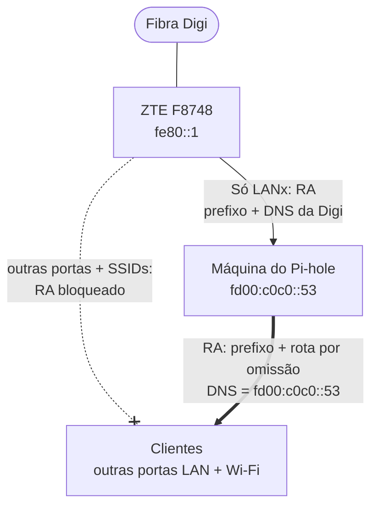

# IPv6 + Pi-hole no ZTE F8748 da Digi (e como contornar o problema)

[English](README.md) · **Português** · [Español](README.es.md)

> 🌐 **Tradução automática.** Este ficheiro foi traduzido automaticamente a partir do [README em inglês](README.md). Em caso de dúvida ou diferença, a versão inglesa é a de referência.

Se tens fibra da **Digi** com o router **ZTE ZXHN F8748** e usas **Pi-hole** (ou AdGuard Home, ou simplesmente dnsmasq), ativar o IPv6 na tua rede local contorna silenciosamente a tua filtragem de DNS.

O router anuncia os servidores DNS IPv6 da própria Digi a todos os dispositivos, e **não há nenhuma opção que o impeça**.

Existe uma opção de "DNS manual": o router ignora-a por completo.

Portanto, Digi: não é raiva, é desilusão. Não, espera. É raiva. Muita raiva. É a versão informática de um senhorio que fica com uma chave suplente e entra quando lhe apetece para pendurar um retrato dele próprio por cima da tua fotografia de família no corredor.

Deixem as pessoas controlar os seus dispositivos e configurar o seu próprio DNS. Fazemos exatamente isso com IPv4 há décadas. Com que direito é que vêm sequestrar as nossas configurações IPv6?

Este repositório documenta o que o router realmente faz, tudo o que *não* resolve o problema, e uma solução que resolve: pôr a máquina do Pi-hole a enviar os anúncios de router (Router Advertisements) IPv6 em vez do router.

> Testado na Digi **Portugal**. Utilizadores da Digi Espanha relatam o mesmo comportamento no F8748 e em routers ZTE mais antigos da Digi (H298Q, H3600P), por exemplo no [bandaancha.eu](https://bandaancha.eu/foros/desactivar-dns-digi-ipv6-router-zte-zxhn-1757717).

---

## Índice

- [Resumo](#resumo)
- [O problema](#o-problema)
  - [O que o router anuncia](#o-que-o-router-anuncia)
  - [O que não resolve](#o-que-não-resolve)
  - [Bónus: o prefixo também não é fixo](#bónus-o-prefixo-também-não-é-fixo)
- [A solução](#a-solução)
  - [Requisitos](#requisitos)
- [Passo a passo](#passo-a-passo)
  - [1. Router (ZTE F8748)](#1-router-zte-f8748)
  - [2. Máquina do Pi-hole: um endereço DNS fixo (ULA)](#2-máquina-do-pi-hole-um-endereço-dns-fixo-ula)
  - [3. Máquina do Pi-hole: encaminhamento IPv6](#3-máquina-do-pi-hole-encaminhamento-ipv6)
  - [4. Pi-hole: enviar os RAs](#4-pi-hole-enviar-os-ras)
  - [5. Verificar num cliente](#5-verificar-num-cliente)
  - [6. Limpar clientes antigos](#6-limpar-clientes-antigos)
- [O que acontece quando o prefixo muda](#o-que-acontece-quando-o-prefixo-muda)
- [Ressalvas](#ressalvas)
- [Testado com](#testado-com)

---

## Resumo

1. No ZTE: mantém o **RA Service ligado**, mas em **Port Control** ativa o RA **apenas na porta onde está ligada a máquina do Pi-hole**. Desativa o DHCPv6 em todas as portas.
2. Na máquina do Pi-hole: adiciona um **ULA** fixo (por exemplo `fd00:c0c0::53`), para que o endereço DNS que os clientes recebem nunca mude.
3. Na máquina do Pi-hole: confirma que o **encaminhamento IPv6** (forwarding) está ativo.
4. No Pi-hole: ativa o servidor DHCP com **"Enable additional IPv6 support (SLAAC + RA)"**.
5. Resultado: os clientes recebem endereços IPv6, uma rota por omissão e DNS a partir da máquina do Pi-hole. O DNS da Digi nunca lhes chega.

---

## O problema

### O que o router anuncia

Com o IPv6 ativo na rede local, o F8748 envia Router Advertisements (RAs) para SLAAC. Esses RAs incluem uma opção **RDNSS** (RFC 8106) com os servidores DNS da Digi:

```text
$ rdisc6 eth0
 ...
 Prefix                   : 2001:db8:1234:5600::/64
  On-link                 :          Yes
  Autonomous address conf.:          Yes
 Recursive DNS server     : 2a12:26c0:0:1::1
 Recursive DNS server     : 2a12:26c0:0:2::1
  DNS servers lifetime    :          900 (0x00000384) seconds
 from fe80::1
```

(`2001:db8::/32` é um prefixo de documentação que substitui o teu prefixo real. Os dois servidores DNS são os servidores reais da Digi.)

Todos os clientes os recebem. O Android *só* usa RDNSS para DNS IPv6, e Linux, Windows, macOS e iOS usam-nos alegremente em paralelo com o teu Pi-hole (ou, quase de certeza, em vez dele). A tua filtragem passa a ter um buraco do tamanho do teu ISP.

### O que não resolve

Tudo isto está nas definições **LAN → IPv6** do router:

| Tentativa | Resultado |
| --- | --- |
| **DNS Delegate Type: Auto** ("DNS Address Through") | Passa o DNS da Digi diretamente aos clientes. É a opção por omissão. |
| **DNS Delegate Type: Manual**, campos de DNS vazios | Recusado: *"Please configure one DNS server address at least."* |
| **Manual** com o endereço IPv6 do teu Pi-hole | Primeiro falha com *"The prefixes to be delegated cannot be empty"* (solução: pôr o **Prefix Delegate Type** do DHCPv6 em **Disabled**). Depois grava e mantém-se após recarregar a página, **mas os RAs continuam a anunciar o DNS da Digi.** |
| Desligar e voltar a ligar o RA Service | Nenhuma diferença. |
| Reiniciar o router | Nenhuma diferença. |
| Flags M/O desligadas, servidor DHCPv6 desligado | Definições corretas para SLAAC, mas o RDNSS continua a ser o da Digi. |
| Desligar o RA por completo | Deixa de haver IPv6 na rede local. Voltamos à estaca zero. |

Ao que parece, a opção de DNS manual só alimenta o servidor DHCPv6 do router, que a maioria dos clientes nunca usa. O RDNSS dos RAs está fixo no que a Digi fornecer do lado WAN.

### Bónus: o prefixo também não é fixo

O RA anuncia o prefixo com tempos de vida válido e preferido **infinitos**, o que sugere que é estático. Não é: muda a cada reinício do router e a cada religação da WAN. Portanto, mesmo que a opção de DNS manual funcionasse, fixar no router um endereço IPv6 do Pi-hole deixaria de funcionar da próxima vez que a ligação caísse.

---

## A solução

Usar o próprio **Port Control** do router para limitar os seus RAs a uma única porta, aquela onde está a máquina do Pi-hole, e pôr a máquina do Pi-hole a enviar RAs para todos os outros.



- A máquina do Pi-hole recebe o prefixo atual do ZTE (é o único dispositivo que ouve os RAs do ZTE).
- O dnsmasq do Pi-hole volta a anunciar esse prefixo à rede local, com **ele próprio** como servidor DNS e como router IPv6 por omissão. O servidor DNS é um endereço privado fixo (um ULA) na máquina do Pi-hole, por isso não muda quando o prefixo muda.
- Os clientes enviam o tráfego IPv6 para a máquina do Pi-hole, que o reencaminha para o ZTE. O tráfego de resposta vai diretamente do ZTE para o cliente, porque o prefixo está na mesma ligação (on-link).
- Quando a Digi muda o prefixo, a máquina do Pi-hole recebe o novo e o dnsmasq anuncia-o automaticamente, descontinuando o antigo.

Na prática, a máquina do Pi-hole transporta muito pouco tráfego. Como reenvia os pacotes pela mesma interface por onde chegaram, o Linux envia aos clientes redirecionamentos ICMPv6 a apontar para o ZTE, e depois dos primeiros pacotes a maior parte do tráfego vai diretamente para o router (`ip -6 route show cache` num cliente mostra entradas `via fe80::1`). Isto é inofensivo e alivia o Pi, mas explica porque é que um traceroute pode não mostrar a máquina do Pi-hole. O DNS não é afetado: continua a ir para onde o RA diz.

### Requisitos

- Uma máquina Linux (testado com um RPi 4; quase tudo o que não seja literalmente uma torradeira deve servir) com Pi-hole (ou dnsmasq, ou o teu serviço de DNS preferido), que possa ficar **sozinha numa porta LAN do ZTE**. Se partilhar um switch com outros dispositivos, esses dispositivos também ouvem os RAs do ZTE e recebem o DNS da Digi.
- Com Docker: o contentor do Pi-hole precisa de `network_mode: host` e `cap_add: [NET_ADMIN]`. Ou podes corrê-lo diretamente e poupar-te a umas dores de cabeça.

---

## Passo a passo

### 1. Router (ZTE F8748)

**LAN → IPv6** (o caminho exato no menu pode variar entre versões de firmware):

- **DHCPv6 Server:** desligado. As definições de DNS aqui deixam de importar.
- **RA Service:** ligado, **M:** desligado, **O:** desligado, **Prefix Delegate Type:** Auto (se o mudaste para Disabled ao experimentar o DNS manual, volta a pô-lo em Auto).
- **Port Control:**
  - **RA** ativo **apenas** na porta LAN onde está ligada a máquina do Pi-hole.
  - **RA** desativado em todas as outras portas LAN e em **todos os SSIDs**.
  - **DHCPv6** desativado em todo o lado (incluindo na porta da máquina do Pi-hole).

Carrega em **Apply** em *cada* secção que alterares. O ZTE pode gravá-las separadamente (ou não, quem sabe).

Já que estás aí, confirma o nível da **firewall IPv6** do router. Com o IPv6 ativo, todos os dispositivos têm um endereço público, e a filtragem do tráfego de entrada é tarefa do router.

### 2. Máquina do Pi-hole: um endereço DNS fixo (ULA)

O Pi-hole diz aos clientes para usarem os seus próprios endereços como servidores DNS. Dá-lhe um que nunca mude: um **ULA**, um endereço IPv6 privado, o equivalente a `192.168.x.x`.

Escolhe qualquer endereço em `fd00::/8`. Este guia usa `fd00:c0c0::53` (`53` é a porta do DNS, `c0c0` lê-se "cocó", uma avaliação justa do firmware do ZTE). O RFC 4193 diz que os bits a seguir a `fd` devem ser aleatórios, o que só importa se um dia juntares esta rede a outra através de uma VPN; evita o simples `fd00::/64`, que muitas redes domésticas usam.

Com NetworkManager (por exemplo, Raspberry Pi OS). Descobre o nome da tua ligação com `nmcli -t -f NAME,DEVICE con show --active`:

```bash
sudo nmcli con mod "Wired connection 1" +ipv6.addresses fd00:c0c0::53/64
sudo nmcli con up "Wired connection 1"           # a rede cai durante alguns segundos
ip -6 addr show eth0                             # deve aparecer fd00:c0c0::53 na lista
```

Com a Opção A do passo 4, não é preciso mais nada: a configuração do dnsmasq gerada pelo Pi-hole já anuncia o ULA da máquina como servidor DNS (é o `[fd00::]` na sua linha `option6:dns-server`). Não acrescentes a tua própria linha `dhcp-option=option6:dns-server`; entraria em conflito com a do Pi-hole.

#### Porque não o endereço global?

A mesma linha do Pi-hole também anuncia um dos endereços globais da máquina (o `[::]`), e foi nisso que confiei ao início. Funciona, mas não é algo de que se deva depender:

- O endereço global muda com o prefixo, ou seja, a cada reinício do router e a cada religação da WAN.
- Depois de uma mudança de prefixo, o dnsmasq continuou a anunciar um endereço global **antigo e descontinuado**, mesmo havendo um mais recente em uso. Só mudou depois de a ligação de rede da máquina ser reiniciada (`nmcli con up`). Os endereços descontinuados expiram ao fim de umas duas horas, e a partir daí os clientes podem ficar com um servidor DNS que já não existe.

Os clientes recebem também o ULA e o endereço link-local da máquina, por isso a filtragem continua a funcionar de qualquer forma; o endereço desatualizado só causa pesquisas lentas enquanto os clientes esperam pelo timeout. É o ULA que torna isto fiável.

Se mesmo assim quiseres um endereço global previsível (útil para testes e para saberes onde está o teu Pi-hole), um endereço com **token** mantém um sufixo fixo (`::2`) em qualquer que seja o prefixo atual:

```bash
sudo nmcli con mod "Wired connection 1" \
  ipv6.method auto ipv6.addr-gen-mode eui64 ipv6.token ::2
sudo nmcli con up "Wired connection 1"           # a rede cai durante alguns segundos
ip -6 addr show eth0                             # deve aparecer <prefixo>::2
```

O `addr-gen-mode eui64` é obrigatório; o NetworkManager ignora o token no modo stable-privacy, que é o modo por omissão.

### 3. Máquina do Pi-hole: encaminhamento IPv6

A máquina passa a ser o gateway IPv6 da rede local, por isso tem de encaminhar tráfego:

```bash
sysctl net.ipv6.conf.all.forwarding          # deve ser 1
sudo ip6tables -S FORWARD | head             # verifica a política / as chains do Docker
```

Para o ativar de forma permanente:

```bash
echo 'net.ipv6.conf.all.forwarding=1' | sudo tee /etc/sysctl.d/90-ipv6-forward.conf
sudo sysctl --system
```

Notas:

- Se usas o Tailscale como subnet router ou exit node, o encaminhamento provavelmente já está ativo.
- O Docker pode pôr a política FORWARD do ip6tables em `DROP`. Nesse caso, permite o tráfego rede local → router, por exemplo `sudo ip6tables -I DOCKER-USER -i eth0 -o eth0 -j ACCEPT`.
- Numa máquina que **não** use NetworkManager, ativar o encaminhamento faz o kernel ignorar os RAs, a não ser que também definas `net.ipv6.conf.eth0.accept_ra=2`. Caso contrário, a máquina perde o seu próprio endereço IPv6. O NetworkManager trata dos RAs ele próprio, por isso não é afetado.

### 4. Pi-hole: enviar os RAs

#### Opção A (a que usei): o servidor DHCP do Pi-hole

Settings → DHCP:

- Ativa o **DHCP server** (também vai servir IPv4 na gama que definires; mantém os endereços estáticos fora dessa gama).
- Se o ZTE ainda tiver o seu próprio **servidor DHCP IPv4** ativo, desliga-o. Dois servidores DHCP na mesma rede significa que os clientes ficam com a resposta que chegar primeiro.
- Marca **"Enable additional IPv6 support (SLAAC + RA)"**.

#### Opção B (não testada): RA sem DHCP

Settings → All settings (expert) → Miscellaneous → `misc.dnsmasq_lines`:

```text
enable-ra
dhcp-range=::,constructor:eth0,ra-only
ra-param=eth0,60,1800
dhcp-option=option6:dns-server,[fd00:c0c0::53],[fe80::]
```

O `constructor:eth0` copia os prefixos que estiverem em `eth0` em cada momento, por isso as mudanças de prefixo são acompanhadas automaticamente. O `ra-param` define um intervalo de 60 s entre RAs e um tempo de vida de router de 1800 s. A linha `dhcp-option` anuncia como servidores DNS o ULA do passo 2 e o endereço link-local da máquina; com o servidor DHCP do Pi-hole desligado, o Pi-hole não gera esta linha sozinho.

Com dnsmasq simples (sem Pi-hole), as linhas da Opção B funcionam tal como estão num ficheiro de configuração do dnsmasq.

### 5. Verificar num cliente

```bash
rdisc6 <interface>
```

Queres **uma única** origem de RAs, o endereço link-local da máquina do Pi-hole, com um tempo de vida de router diferente de zero e apenas o Pi-hole como DNS:

```text
Stateful address conf.    :           No
Stateful other conf.      :          Yes
Router lifetime           :         1800 (0x00000708) seconds
 Prefix                   : fd00:c0c0::/64
  Autonomous address conf.:          Yes
 Prefix                   : 2001:db8:1234:5600::/64
  Autonomous address conf.:          Yes
 Recursive DNS server     : 2001:db8:1234:5600:xxxx:xxxx:xxxx:xxxx
 Recursive DNS server     : fd00:c0c0::53
 Recursive DNS server     : fe80::xxxx:xxxx:xxxx:xxxx
 from fe80::xxxx:xxxx:xxxx:xxxx
```

(Com a Opção B, `Stateful other conf.` mostra `No`. É o esperado, porque não há DHCPv6. Com a Opção A, cada servidor DNS aparece duas vezes; é assim que o Pi-hole escreve a opção, e é inofensivo.)

Nada de servidores `2a12:26c0:…`, nenhum RA vindo de `fe80::1`. Continuas a vê-los num dispositivo que já estava ligado antes? Vê o [passo 6](#6-limpar-clientes-antigos). Depois:

```bash
ip -6 route                                   # uma única rota por omissão, via a máquina do Pi-hole
ping -6 -c3 google.com                        # o encaminhamento IPv6 funciona
resolvectl status <interface>                 # só aparecem endereços do Pi-hole
dig @fd00:c0c0::53 doubleclick.net AAAA       # deve dar ::  (bloqueado)
dig @fd00:c0c0::53 example.com AAAA           # deve dar um endereço real
```

### 6. Limpar clientes antigos

Os dispositivos que estavam ligados enquanto os RAs do ZTE lhes chegavam ficam com restos. Os servidores DNS da Digi (tempo de vida de 15 min) e a rota por omissão extra via `fe80::1` (30 min) expiram sozinhos. Os endereços de um prefixo antigo podem não expirar: o ZTE anunciou-os com tempo de vida infinito, e se esse prefixo foi substituído sem ser descontinuado, o endereço fica. O cliente pode então usá-lo como endereço de origem, e o IPv6 falha de forma intermitente. Volta a ligar cada dispositivo uma vez (desliga e liga o Wi-Fi, reinicia, ou `nmcli device disconnect <if> && nmcli device connect <if>`) para limpar tudo de uma vez.

---

## O que acontece quando o prefixo muda

O prefixo muda a cada reinício do router **e** a cada religação da WAN (por exemplo, uma quebra na fibra), por isso conta com isto no uso normal. Testado das duas formas:

1. O ZTE descontinua o prefixo antigo e anuncia um novo à máquina do Pi-hole.
2. A máquina do Pi-hole obtém um endereço no novo prefixo. O endereço antigo fica marcado como `deprecated` e expira ao fim de ~2 horas (a regra das duas horas do RFC 4862).
3. O dnsmasq anuncia o novo prefixo e passa o antigo como descontinuado.
4. Os clientes obtêm um endereço do novo prefixo e começam logo a usá-lo. Os endereços antigos expiram da mesma forma.
5. O endereço DNS que os clientes usam, `fd00:c0c0::53`, não muda de todo.

Durante um ou dois segundos, enquanto o novo endereço da máquina do Pi-hole ainda está a ser verificado contra duplicados, o dnsmasq anuncia um tempo de vida de router de 0. Um cliente que ouça esse RA perde brevemente a sua rota IPv6 por omissão. Recupera sozinho: depois da mudança, os clientes voltaram a ter uma única rota por omissão via a máquina do Pi-hole.

Não é preciso intervenção manual.

---

## Ressalvas

- **A máquina do Pi-hole passa a ser o teu gateway IPv6.** Se for abaixo, os clientes perdem o IPv6 (e provavelmente o IPv4, portanto, hmm, hora de ir fazer um piquenique).
- **O isolamento da porta é importante.** Tudo o que partilhe a porta do router da máquina do Pi-hole (por exemplo, através de um switch) também ouve os RAs do ZTE e recebe o DNS da Digi.
- **As estatísticas do Pi-hole ficam mais confusas.** Os clientes usam endereços IPv6 de privacidade que vão rodando, por isso as estatísticas por cliente das consultas IPv6 não correspondem de forma clara a dispositivos.
- **DoH/DoT continuam a contornar o Pi-hole**, tal como em IPv4. Isso é outro problema.
- **Tudo recebe também um endereço ULA.** O dnsmasq anuncia todos os prefixos em `eth0`, incluindo o ULA, por isso os clientes recebem um endereço `fd00:c0c0::…` além do global. Continuam a usar o global para a internet. A máquina do Pi-hole também apanha o seu próprio anúncio e ganha um segundo endereço ULA (`fd00:c0c0::2` se definiste o token `::2`). Ambos são inofensivos; confirma que a única rota por omissão da máquina continua a ser `via fe80::1` (`ip -6 route show default`).

---

## Testado com

| | |
| --- | --- |
| ISP | Digi (Portugal), FTTH |
| Router | ZTE ZXHN F8748, firmware: *F8748 V3.0.10P2N9* |
| Máquina do Pi-hole | Raspberry Pi, Raspberry Pi OS (baseado em Debian), NetworkManager |
| Pi-hole | v6, Docker, `network_mode: host`, `NET_ADMIN` |
| Clientes | Ubuntu 24.04 (NetworkManager + systemd-resolved) |

Se experimentaste isto noutros modelos ZTE da Digi ou noutras versões de firmware, PRs e issues são bem-vindos.

## Aviso legal

Isto é uma descrição do que funcionou numa rede. O firmware dos routers muda, os menus mudam de sítio, e és responsável pela tua própria configuração. Sem qualquer ligação à Digi, à ZTE ou ao Pi-hole.
